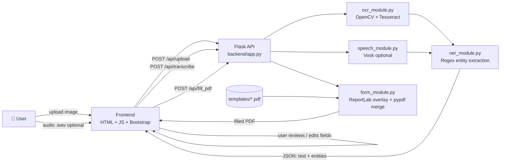

<div align="center">

# 🪪 AI-Powered Form Filling Assistant for Indian Citizen Services

**Upload a scanned ID → OCR reads it → entities are extracted → a PDF form is filled automatically.**


### 🚀 [**Try the Live Demo →**](https://saniya1312s.github.io/intel-ai-form-filling-assistant/)

<sub>Runs entirely in your browser (Tesseract.js + pdf-lib). No installation, and no data leaves your device.</sub>

</div>

---

## 📑 Table of Contents

1. [Overview](#-overview)
2. [Live Demo](#-live-demo)
3. [Problem Statement](#-problem-statement)
4. [Key Features](#-key-features)
5. [System Architecture](#-system-architecture)
6. [Tech Stack](#-tech-stack)
7. [Project Structure](#-project-structure)
8. [How Each Module Works](#-how-each-module-works)
9. [API Reference](#-api-reference)
10. [Installation & Setup](#-installation--setup)
11. [Usage Guide](#-usage-guide)
12. [Sample Run (Real Output)](#-sample-run-real-output)
13. [Known Limitations](#-known-limitations)
14. [Future Improvements](#-future-improvements)
15. [Skills Demonstrated](#-skills-demonstrated)
16. [Disclaimer](#-disclaimer)
17. [License & Author](#-license--author)

---

## 🔍 Overview

Government and citizen-service forms (passport, PAN, Aadhaar, voter ID) ask applicants to type the same details again and again, such as name, date of birth, ID number and address. This is slow and error-prone.

This project is a **compact, end-to-end demo** of an AI assistant that removes that repetition. A user uploads a scanned identity document; the system **reads it with OCR, pulls out the key fields with an entity-extraction layer, lets the user review and correct them, and then writes them onto a PDF form template** ready for download.

It is intentionally lightweight, with a Flask backend, a plain HTML/JS frontend and regex-based extraction, so the whole pipeline can be understood, run and extended on a laptop.

## 🌐 Live Demo

**👉 https://saniya1312s.github.io/intel-ai-form-filling-assistant/**

The root `index.html` is a self-contained dashboard hosted with GitHub Pages. Click **Sample Aadhaar** or **Sample PAN**, or upload your own PNG/JPG, and watch the pipeline run step by step: *Upload → Preprocess → OCR → Extract → Review → Fill PDF*. The dashboard shows OCR confidence, number of fields found and processing time, lets you edit the fields, and previews and downloads the filled PDF.

### Live demo vs. Flask version

GitHub Pages can only serve static files, so the hosted demo re-implements the pipeline in the browser. The Python backend is unchanged and remains the full version of the project.

| | 🌐 Live demo (GitHub Pages) | 🐍 Flask app (`backend/`) |
|---|---|---|
| Run with | Open the link | `python -m backend.app` |
| OCR | Tesseract.js (WebAssembly) | pytesseract + Tesseract binary |
| Preprocessing | Grayscale + Otsu threshold on a canvas (toggle) | OpenCV grayscale + median blur + Otsu |
| Extraction | JS port of `ner_module.py` (`demo/extract.js`) | `ner_module.py` |
| PDF filling | pdf-lib, values written next to each template label (`demo/fill.js`) | ReportLab overlay + pypdf |
| Server needed | No | Yes (Flask) |
| Speech input | Not included | Optional Vosk endpoint |

**Differences in the demo's extractor:** the same rules are used for DOB, Aadhaar, PAN and PIN code. Name and address stop at the end of the line (so labels like `DOB` no longer leak into the name), and **father's name** and **gender** are also extracted so the PAN and Aadhaar templates can be filled completely. OCR results can differ slightly from the Python version because the OCR engines differ.

**Privacy:** the image is processed locally in your browser and is not uploaded. Tesseract.js downloads its engine and English language data from a CDN on first use, so an internet connection is needed. This is a demo, so please use only the fictional samples.

### Enabling GitHub Pages for your fork or clone

1. Push this repository to GitHub (`main` branch).
2. Open **Settings → Pages**.
3. Under **Build and deployment**, set **Source** to **Deploy from a branch**.
4. Choose branch **`main`** and folder **`/ (root)`**, then click **Save**.
5. Wait about a minute. The site will be live at `https://<your-username>.github.io/<repo-name>/`.

## 🎯 Problem Statement

| Pain point | How this project addresses it |
|---|---|
| Manual re-typing of the same identity details across many forms | Extracts fields once from a scanned document and reuses them |
| Typing errors in ID numbers and dates | Machine extraction plus a **human review step** before filling |
| Documents arrive as scans or photos, not structured data | OpenCV preprocessing + Tesseract OCR turns pixels into text |
| Different services need different forms | A template dropdown fills Passport, Voter ID, Aadhaar or PAN forms from the same extracted data |

## ✨ Key Features

- 📤 **Document upload** with drag-and-drop and image preview (PNG / JPG)
- 🖼️ **Image preprocessing** with grayscale conversion, median blur denoising and Otsu thresholding using OpenCV
- 🔤 **OCR** with Tesseract via `pytesseract` (English by default, other languages possible if the traineddata is installed)
- 🧠 **Entity extraction** of Name, DOB, Aadhaar number, PAN, PIN code and Address using regex heuristics, with hooks for spaCy / transformers
- ✏️ **Editable review form**, so extracted values can be corrected before filling
- 📝 **PDF form filling** using a ReportLab overlay merged onto the template with `pypdf`
- 📋 **Copy JSON** to export the extracted fields
- 🎙️ **Speech input endpoint** (Vosk-based, optional) that feeds transcribed text to the same extractor
- 🌐 **Live browser demo** hosted on GitHub Pages (no install needed)
- 🗂️ **4 sample form templates** and **2 fictional sample documents** included for testing

## 🏗️ System Architecture



**Pipeline in one line:** `Scan → Preprocess → OCR → Extract entities → Review/Edit → Fill PDF → Download`

## 🧰 Tech Stack

| Layer | Technology | Purpose |
|---|---|---|
| Backend | **Python, Flask** | REST API and static file serving |
| Computer vision | **OpenCV, NumPy, Pillow** | Image preprocessing |
| OCR | **Tesseract, pytesseract** | Text extraction from images |
| NLP | **Regex heuristics** (spaCy / transformers optional) | Entity extraction |
| Speech *(optional)* | **Vosk** | Offline speech-to-text |
| PDF | **ReportLab, pypdf** | Build text overlay and merge it onto the template |
| Frontend | **HTML5, CSS3, JavaScript, Bootstrap 5, Font Awesome** | Upload UI, field review, download |
| Live demo | **Tesseract.js, pdf-lib, GitHub Pages** | Serverless, in-browser version of the pipeline |

## 📁 Project Structure

```
intel-ai-form-filling-assistant/
│
├── index.html               # 🌐 Live demo dashboard (served by GitHub Pages)
├── demo/                    # Browser version of the pipeline
│   ├── app.js               #   UI flow: preprocess → OCR → review → fill
│   ├── extract.js           #   JS port of ner_module.py
│   ├── fill.js              #   PDF filling with pdf-lib
│   └── style.css
│
├── backend/                 # 🐍 Full Flask version
│   ├── app.py               #   Flask app and API endpoints (port 7860)
│   ├── ocr_module.py        #   Image preprocessing + Tesseract OCR
│   ├── ner_module.py        #   Regex-based entity extraction
│   ├── speech_module.py     #   Vosk speech transcription (optional)
│   ├── form_module.py       #   PDF overlay creation and merge
│   └── requirements.txt     #   Python dependencies
│
├── frontend/                # UI used by the Flask app
│   ├── index.html
│   ├── main.js
│   └── style.css
│
├── templates/               # Blank (fictional) PDF form templates (used by both versions)
│   ├── aadhaar_form.pdf
│   ├── pan_form.pdf
│   ├── passport_form.pdf
│   └── voter_id_form.pdf
│
├── sample_docs/             # Fictional sample documents (used by both versions)
│   ├── sample_aadhaar.png
│   └── sample_pan.png
│
├── output/                  # Generated filled PDFs from the Flask app (git-ignored)
├── docs/
│   └── project-notes.md     # Extraction rules, design decisions and test notes
│
├── .nojekyll                # Tells GitHub Pages to serve files as-is
├── .gitignore
├── LICENSE
└── README.md
```

## ⚙️ How Each Module Works

### 1. `ocr_module.py` — Image → Text
1. Loads the image with OpenCV (`cv2.imread`)
2. Converts to **grayscale**, applies a **3×3 median blur** to remove noise
3. Applies **Otsu's binarisation** to separate text from background
4. Passes the cleaned image to `pytesseract.image_to_string` (`lang='eng'` by default)

### 2. `ner_module.py` — Text → Structured Fields
Rule-based extraction using regular expressions:

| Field | Rule |
|---|---|
| `name` | Text after a `Name` label (1–4 capitalised words); falls back to the first two-word capitalised phrase |
| `dob` | `DD-MM-YYYY`, `DD/MM/YYYY` or `YYYY-MM-DD`-style date patterns |
| `aadhaar` | 12 digits in a 4-4-4 grouping (spaces or hyphens allowed), normalised to plain digits |
| `pan` | 5 uppercase letters + 4 digits + 1 uppercase letter (e.g. `ABCDE9999F`) |
| `pincode` | A standalone 6-digit number |
| `address` | Text following an `Address` label (10–200 characters) |

### 3. `form_module.py` — Fields → Filled PDF
Builds a one-page ReportLab canvas that writes each `key: value` pair, then merges that overlay onto every page of the chosen template with `pypdf`.

### 4. `speech_module.py` — Voice → Text *(optional)*
Transcribes **16-bit mono PCM WAV** audio with Vosk and passes the text to the same extractor. If Vosk is not installed, the endpoint returns a clear error instead of crashing.

### 5. `app.py` — Orchestration
Serves the frontend and exposes three JSON/file endpoints (below). Uploaded files are saved with `secure_filename` to avoid unsafe filenames.

## 🔌 API Reference

Base URL: `http://localhost:7860`

| Method | Endpoint | Request | Response |
|---|---|---|---|
| `GET` | `/` | none | Frontend (`index.html`) |
| `POST` | `/api/upload` | `multipart/form-data`, field `file` (image) | `{ "text": "...", "entities": { ... } }` |
| `POST` | `/api/transcribe` | `multipart/form-data`, field `file` (WAV audio) | `{ "text": "...", "entities": { ... } }` |
| `POST` | `/api/fill_pdf` | JSON: `{ "template": "pan_form.pdf", "fields": { ... } }` | Filled PDF as a file download |

Errors return JSON `{ "error": "..." }` with status `400` (bad input) or `500` (processing failure).

**Example: call the API directly**

```bash
# 1. Extract fields from a sample document
curl -F "file=@sample_docs/sample_pan.png" http://localhost:7860/api/upload

# 2. Fill the PAN template with those fields
curl -X POST http://localhost:7860/api/fill_pdf \
  -H "Content-Type: application/json" \
  -d '{"template":"pan_form.pdf","fields":{"name":"SAMPLE PERSON","pan":"ABCDE9999F"}}' \
  -o filled_pan_form.pdf
```

## 🚀 Installation & Setup

### Prerequisites
- **Python 3.9+**
- **Tesseract OCR engine** (the system binary, not just the Python package)

| OS | Install Tesseract |
|---|---|
| Ubuntu / Debian | `sudo apt install tesseract-ocr` |
| macOS | `brew install tesseract` |
| Windows | Install from the [UB Mannheim builds](https://github.com/UB-Mannheim/tesseract/wiki) and add it to `PATH` |

### Steps

```bash
# 1. Clone the repository
git clone https://github.com/Saniya1312S/intel-ai-form-filling-assistant.git
cd intel-ai-form-filling-assistant

# 2. (Recommended) create a virtual environment
python -m venv venv
source venv/bin/activate        # Windows: venv\Scripts\activate

# 3. Install dependencies
pip install -r backend/requirements.txt

# 4. Run the app FROM THE REPOSITORY ROOT
python -m backend.app
```

Open **http://localhost:7860** in your browser.

> ⚠️ **Run from the repository root with `python -m backend.app`.** `app.py` imports `from backend import ...`, so running `python backend/app.py` from inside the folder will fail with an import error.

> 💡 The requirements file lists optional heavy packages (`vosk`, `spacy`, `transformers`, `torch`). The core demo (upload → OCR → extract → fill PDF) does not need them. If you only want the core pipeline, install the first group and skip the optional ones.

## 🖱️ Usage Guide

1. **Start the server** and open `http://localhost:7860`.
2. **Upload** `sample_docs/sample_aadhaar.png` or `sample_docs/sample_pan.png` (or your own image) and click **Upload & Extract**.
3. **Review** the extracted fields in the form on the right and correct any value.
4. **Choose a template** (Passport, Voter ID, Aadhaar, PAN) from the dropdown.
5. Click **Fill PDF & Download** to get the filled form, or **Copy JSON** to export the data.

## 🧪 Sample Run (Real Output)

Running the pipeline on the bundled fictional PAN sample (`sample_docs/sample_pan.png`), with Tesseract 5 and the code exactly as in this repository, produced:

```json
{
  "name": "SAMPLE PERSON\n\nFather",
  "dob": "01-01-1990",
  "pan": "ABCDE9999F",
  "pincode": "560001",
  "address": "123 Fctona Lane"
}
```

And on `sample_aadhaar.png`:

```json
{
  "name": "SAMPLE PERSON\nDOB",
  "dob": "01-01-1990",
  "aadhaar": "999900001111",
  "pincode": "560001",
  "address": "123 Fctona Lane"
}
```

Structured identifiers (DOB, PAN, Aadhaar, PIN code) are extracted reliably. Free-text fields (name, address) show the weaknesses of the current approach, covered under [Known Limitations](#-known-limitations). This is why the **review-and-edit step** exists in the UI.

## ⚠️ Known Limitations

Documented honestly so the next iteration is clear:

| Area | Current behaviour | Impact |
|---|---|---|
| **Name regex** | The pattern's `\s` can match across line breaks, so trailing labels such as `DOB` or `Father` can leak into `name` | User must edit the name before filling |
| **Address** | Captures only until the first character outside `[A-Za-z0-9,-\s]`, and the OCR of the small address line is noisy | Address is often truncated or misspelt |
| **PDF input** | The UI accepts `.pdf`, but `ocr_module` reads images with `cv2.imread`; `pdf2image` is installed but not wired in | Upload scans as PNG/JPG |
| **PDF layout** | `form_module` writes `key: value` lines at fixed coordinates, not into the template's blank lines | Text can overlap the template's printed labels |
| **"Use Sample" button (Flask UI)** | Placeholder logic in `main.js` is unfinished (it works in the live demo) | In the Flask UI, select the files in `sample_docs/` manually |
| **Speech** | Backend endpoint exists; the frontend has no recording UI. Needs 16-bit mono WAV | API-only feature for now |
| **Language** | English OCR model only by default | Hindi / regional text needs extra traineddata |
| **Security** | Flask runs with `debug=True`, `host=0.0.0.0`; uploads are written to `sample_docs/` | **Development use only**; do not deploy as is |
| **Data** | Heuristics only; spaCy / transformers are listed but not integrated | Limited generalisation to real-world layouts |

## 🔮 Future Improvements

- [ ] Fix name / address regexes to stop at line breaks and known label words
- [ ] Place filled values at per-field coordinates (or use AcroForm fields) instead of fixed-position lines
- [ ] Wire `pdf2image` into the OCR step for true PDF input
- [ ] Complete the "Use Sample" button in the Flask UI (already working in the live demo)
- [ ] Port the live demo's line-aware name/address rules and per-label PDF placement back into the Python backend
- [ ] Plug in spaCy / transformer-based NER and compare with the regex baseline
- [ ] Add Hindi and other Indian-language OCR (`hin`, `mar`, …)
- [ ] Add a microphone recording UI for the speech endpoint
- [ ] Per-field confidence scores to highlight low-confidence values for review
- [ ] Unit tests for the extraction rules, with a small labelled evaluation set
- [ ] Dockerfile for one-command setup (includes the Tesseract binary)
- [ ] Production hardening: file-type validation, upload limits, separate upload directory, auth, disable debug mode

## 💼 Skills Demonstrated

`Python` · `Flask / REST API design` · `OCR (Tesseract)` · `Image preprocessing (OpenCV)` · `Regex-based NLP / Information extraction` · `PDF generation and manipulation` · `Frontend integration (HTML/JS/Bootstrap)` · `Client-side OCR and PDF generation (Tesseract.js, pdf-lib)` · `Static hosting with GitHub Pages` · `End-to-end pipeline design` · `Human-in-the-loop UX` · `Technical documentation`

## 📜 Disclaimer

This is an **educational demo**. All sample documents and PDF templates are **fictional** and carry no real personal data. They are **not** official government documents or forms. Do not upload real identity documents to a development build of this app, and do not use it as is in production.

## 📄 License & Author

Released under the **MIT License**. See [LICENSE](LICENSE).

**Author:** [@Saniya1312S](https://github.com/Saniya1312S)

⭐ If you found this project useful, consider giving the repository a star.
